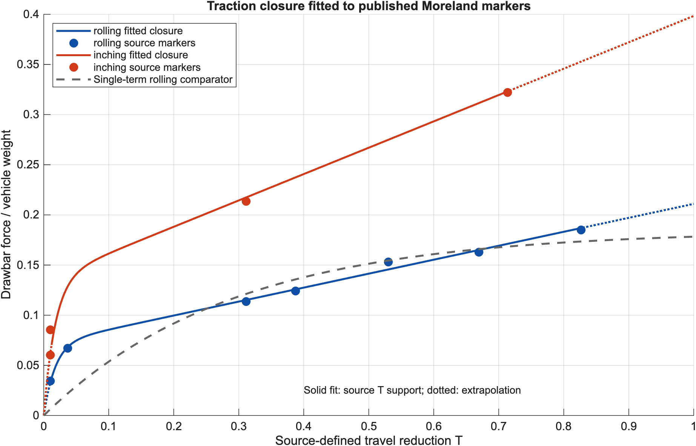

# Supplementary Materials: Rover Locomotion on Granular Terrain

Supplementary code, data, and reproducibility materials for **Energy Efficiency of Rover Locomotion on Granular Terrain: A Comparative Modeling Study**, by Oliver Cheng, Yolanda Fan, and Yixuan Liang.

The project compares rolling, inching, and screw propulsion through published experimental evidence, traction fitting, dimensional analysis, and conditional energy scenarios. It contains a secondary-data modeling study, not new rover experiments or a validated Mars vehicle design.

The [manuscript](docs/Manuscript_Final.docx) and [model documentation](docs/MODEL_NOTES.md) describe the assumptions, equations, and interpretation. The instructions below reproduce the reported calculations and figures from the supplied data.



## Quick start

The recorded analysis used **base MATLAB R2026a Update 3** on Apple silicon. No Optimization or Statistics Toolbox is required. Earlier MATLAB releases and GNU Octave have not been verified.

Open MATLAB, make this repository your current folder, and run:

```matlab
run_conservative_model
```

The supplied CSV inputs are sufficient; an internet connection is unnecessary for this step. The script regenerates `results/` and `figures/`, replacing their existing outputs. It uses 10,000 paired scenario draws with seed `20260922`.

To independently check the saved numerical results, use Python with NumPy 1.22 or later:

```bash
python -m pip install -r requirements.txt
python audit/independent_numeric_check.py .
```

The audit refits traction with a separate optimization method, solves roots by bisection, and recomputes scenario statistics from the saved draws. It replaces its own Markdown and JSON reports in `audit/`. The bundled report records **13,608 passing checks**; these establish numerical agreement, not physical validation.

## Selected results

| Analysis | Recorded result | Interpretation |
| --- | --- | --- |
| Inching traction multiplier | 1.888 | Fitted to four inching markers relative to a curve fitted to seven rolling markers; compared at equal source-defined travel reduction. |
| Baseline energy scenario at drawbar ratio 0.10 | Median proxy: rolling 0.2501, inching 0.1682 | A 32.7% reduction relative to the rolling median, conditional on the selected power and resistance assumptions. |
| Conditional wheel power-number prediction | Holdout MAPE: 3.02% pneumatic, 5.23% rigid | Uses observed travel reduction; later samples come from the same published experiment. |
| Published screw scaling check | Pooled MAPE: 3.90% power, 5.33% speed | Reanalysis of ten published measured–predicted pairs for HGSL2 and HGSL3. |

Detailed values are in [`results/summary.json`](results/summary.json) and the accompanying CSV tables.

## Model and limitations

The traction coordinate is **travel reduction**, `T = 1 - v/v_ref`, using each source's reference speed. It is not automatically kinematic wheel slip. The fitted closures are:

```text
phi_roll(T) = alpha * (1 - exp(-T/K)) + beta * T
phi_inch(T) = lambda * phi_roll(T)
```

The duty and slope calculations use a **mechanical cost-of-transport proxy**. In the identity `C = Q/(1-T)`, the closures for normalized power `Q` are assumed, rather than measured by the traction data. The baseline fixes the inching resistance factor at `eta = 0.5`; a separate sensitivity analysis varies it from 0.5 to 1.0. Percentile bands describe selected scenarios with fixed traction fits, not experimental confidence intervals.

All slope calculations assume transfer of a flat-bed fit. Mathematical limits obtained by extrapolating to `T = 1` are not measured climb limits. Wheel and screw evidence uses different vehicles, media, and energy boundaries, so the repository does not establish a universal three-mode efficiency ranking or Mars performance limits.

## Source extraction and independence

The inputs reconstruct published figure coordinates and reported summaries. They are not original experimental logs. Source definitions, coordinate mappings, extraction bounds, and citations are documented in:

- [`data/WHEEL_PROVENANCE.md`](data/WHEEL_PROVENANCE.md) and [`source_extraction/wheels/PROVENANCE.md`](source_extraction/wheels/PROVENANCE.md)
- [`source_extraction/screws/README.md`](source_extraction/screws/README.md)
- [`data/INDEPENDENT_ENERGY_EVIDENCE.md`](data/INDEPENDENT_ENERGY_EVIDENCE.md)
- [`reference_audit/final_references.json`](reference_audit/final_references.json)

The supplementary reference catalog retains independent numbering. Catalog [23] (NASA/TM-2014-218431) corresponds to reference [22] in the final manuscript; catalog [22], [24], and [25] are additional supporting sources outside the final manuscript’s reference list.

The NASA 2014 report and Creager 2015 article describe the same research, rather than independent energy validations. The screw comparison uses mass-independent ratios because the source table's absolute mass units require interpretation. Cao et al. (2023) values are reported prose summaries, not newly digitized trials.

Optional source reconstruction requires internet access and additional Python packages:

```bash
python -m pip install -r requirements-extraction.txt
python source_extraction/prepare_sources.py
python source_extraction/wheels/extract_wheel_data.py
python source_extraction/screws/extract_pre_figure.py
python source_extraction/screws/build_screw_csv.py
```

Source PDFs are downloaded rather than bundled. The preparation script prints SHA-256 hashes; it does not enforce the recorded hashes. Extraction outputs are written beside the scripts. Compare them with the supplied `data/` files before replacing analysis inputs. Some historical provenance notes mention auxiliary research files not included here.

## Repository contents

```text
run_conservative_model.m   MATLAB analysis and figure generation
data/                      Analysis inputs and provenance notes
results/                   Saved tables, scenario draws, summary, and run log
figures/                   Generated manuscript figures 4–8
audit/                     Independent numerical audit and recorded reports
source_extraction/         Optional published-source reconstruction scripts
reference_audit/           Reference metadata and verification notes
docs/                      Manuscript and detailed model documentation
```

Preserve source citations and provenance when reusing reconstructed data. Codex assisted literature checks, figure-data extraction, model and code refinement, MATLAB execution, numerical verification, figures, and manuscript editing, as disclosed in the manuscript. The authors retain responsibility for reviewing the analysis and its interpretation.

## Rights

No open-source license has been assigned. Preserve author attribution and the rights of cited third-party sources.
